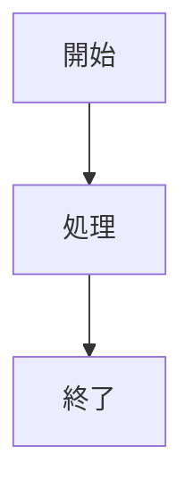

Engawa 制作時に使っていた **マークアップ見本** を1本にまとめた記事です。Markdown 基本、Hugo のレンダーフック、ショートコード、画像、レイアウトフラグを網羅しています。テーマを直すときの見た目チェックリストとして使えます。画像はすべて [placehold.co](https://placehold.co) のリモートプレースホルダーです。

<!--more-->

## 見出しと目次

見出しは6段階。投稿ページでは `h1` がタイトル、本文は通常 `h2` から始めます。

- 本文の上に出る目次は **`h2`〜`h4` のみ** 対応で、常に番号付きリストです（`markup.toml`）。
- `h2`〜`h4` はホバーで `#` アンカーが出ます（`render-heading.html`）。`h5`/`h6` には付きません。

### H3
#### H4
##### H5 — アンカーなし・目次外
###### H6 — アンカーなし・目次外

## 段落とインライン

通常の段落に **太字**、*斜体*、~~取り消し線~~、`インラインコード`、[Hugo へのリンク](https://gohugo.io/)。

生 HTML が許可されているので（`goldmark.renderer.unsafe = true`）、<abbr title="Graphics Interchange Format">GIF</abbr>、H<sub>2</sub>O、X<sup>n</sup>、<kbd>Ctrl</kbd>+<kbd>K</kbd>、<mark>ハイライト</mark> なども使えます。

## 振り仮名

振り仮名はテーマに組み込み（Furifont）。ヘッダー切替で Off / ひらがな / ローマ字を選べ、本文の日本語は自動注釈されます。手動の `<ruby>` は常に尊重され、自動パスで二重にはなりません:

<ruby>東京<rt>とうきょう</rt></ruby>の<ruby>桜<rt>さくら</rt></ruby>はきれいです。

## 引用

> **Markdown** を含む普通の引用。

> Don't communicate by sharing memory, share memory by communicating.<br>
> — <cite>Rob Pike</cite>

### カスタムクラス

引用の*次の行*の属性がクラスになります（`render-blockquote.html` が通し、見た目はスキーム SCSS 次第）:

> カスタムクラス付きの引用。
{.my-class}

### アラート（GFM 風）

> [!NOTE]
> 流し読み時の補足。

> [!TIP]
> より良い結果のための任意のヒント。

> [!IMPORTANT]
> 成功するために必要な情報。

> [!WARNING]
> 注意が必要なこと。

> [!CAUTION]
> 行動による負の結果。

組み込みラベルはページ言語に従います（テーマ i18n `alert.*`）。

タイプ行のテキストでラベルを上書きできます:

> [!TIP] カスタムアラートタイトル
> アラート本体はいつもどおり描画されます。

## 表

| 名前  | 年齢 |
| ----- | ---- |
| Bob   | 27   |
| Alice | 23   |

| 斜体      | 太字     | コード   |
| --------- | -------- | -------- |
| *italics* | **bold** | `code`   |

## コード

言語は任意 — 省略時は Chroma が推測（`guessSyntax = true`）。行番号は全ブロックでオン（`lineNos = true`）。

### フェンス付きブロック

```html
<!doctype html>
<html lang="ja">
  <head>
    <meta charset="utf-8">
    <title>Example</title>
  </head>
  <body>
    <p>Test</p>
  </body>
</html>
```

### Diff

```diff
- features = ["dynamic"]
+ features = ["jpeg", "dynamic"]
```

### ブロックごとのハイライトオプション

言語フェンス後の波括弧、例: `linenos=false`、`linenostart=N`、`hl_lines=[2 4-6]`:

```go {linenos=false, hl_lines=[2]}
package main

func main() {}
```

## リスト

### 番号付き

1. いち
2. に
3. さん

### 箇条書き

* 項目
* 別の項目
* ネスト
  * りんご
  * みかん

### タスクリスト

チェックボックスは disabled の input として描画されます:

- [x] 出荷済み
- [ ] 下書き

## 脚注

goldmark ネイティブの脚注。インライン参照[^note]し、記事末にまとまります。

[^note]: 脚注の定義 — 本文のあとの `footnotes` ブロックに出ます。

## 水平線

この行の上がセクション内容です。

---

テーマ区切り（`hr`）のあとの内容です。

## 画像

画像 — ローカルのページリソースでもリモート URL でも — は lightbox と遅延読み込み付きの `<figure>` になります。横幅 960px 以上のローカル画像は小さめの表示用コピー、1400px 以上は上限付きの全サイズコピーを自動生成します。この exampleSite では [placehold.co](https://placehold.co) のリモート URL のみ使います。

### 単体の図


### キャプション（オプトイン）

title 属性は常に lightbox 側のキャプションに使われます。ページ上のキャプションはサイト設定 `images.showCaptions = true`、または画像ごとに:


{.caption}

`{caption=true}`（デフォルトでオンの場合は `{caption=false}`）でも切り替えられます。

### gallery ショートコード

`cols="2"`（デフォルト）または `cols="3"`。グリッド内のキャプションは lightbox 側に回ります:






## ショートコード（Engawa）

### Quote

`author`・`source`・`url` はすべて省略可能:


Lorem ipsum dolor sit amet, consectetur adipiscing elit, sed do eiusmod tempor incididunt ut labore et dolore magna aliqua.


### Video（リモートファイル）

`src` にはページリソースかリモートファイルを指定。`poster`・`autoplay`・`muted` は任意:



### YouTube



### Bilibili

`BV…` か `av…` の ID を指定。2番目の引数でページ番号も渡せます:



### Tencent Video



### GitLab スニペット



## 未配線（構文サンプルとして保持）

### Mermaid

Engawa はまだ Mermaid JS を同梱していません。`mermaid` フェンスはふつうのコードブロックとして表示されます:



### 数式

KaTeX / MathJax も未導入のため、`$…$` も `$$…$$` もそのまま表示されます:

インライン: `$ \varphi = \dfrac{1+\sqrt{5}}{2} $`

ブロック:

```
$$
f(a) = \frac{1}{2\pi i} \oint_\gamma \frac{f(z)}{z-a}\, dz
$$
```

## この投稿の frontmatter

| フィールド | Engawa での役割 |
| ---------- | ---------------- |
| `title` | ページタイトル（一覧でも使用） |
| `date` | メタパネル・RSS `pubDate`・一覧の並び順 |
| `draft` | ビルドから除外、コメントも出ない |
| `slug` | パーマリンク（`/p/:slug/`） |
| `description` | メタ description。RSS item description のフォールバック |
| `summary` | 投稿ページのリード段落、ホーム/注目の抜粋、RSS フォールバック |
| `categories` / `tags` | メタパネルのチップ、サイドバー/フッターのタクソノミーブロック |
| `image` | 投稿ページのカバー、一覧サムネ、`og:image` |
| `sidebar` | サイドバーの強制表示/非表示 |
| `fullWidth` | コンテンツ列を広げる（サイドバー無効時のみ） |
| `wideFooter` | フッター二次帯。サイドバー無効時は自動でオン |
| `comments` | `false` でこの記事の Disqus 欄を非表示 |
| `weight` | 同日投稿の並び替えタイブレーク |

Engawa のレイアウトが読まない Hugo フィールド: `linkTitle`、`lastmod`（Hugo 内蔵サイトマップのみ使用）、`keywords`。害はありませんが、ページにもテーマにも使われていません。
