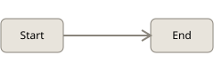

This post consolidates the **markup samples** used while building Engawa: core Markdown, Hugo render hooks, shortcodes, images, and layout flags. Use it as a visual checklist when changing the theme. Images here are remote placeholders from [placehold.co](https://placehold.co).

<!--more-->

## Headings and TOC

Six levels of section headings. On a post page, `h1` is the title; body copy typically starts at `h2`.

- The table of contents (rendered above the body) covers **`h2`–`h4` only**, always as an ordered list (`markup.toml`).
- `h2`–`h4` get a `#` anchor link on hover (`render-heading.html`); `h5`/`h6` do not.

### H3
#### H4
##### H5 — plain heading
###### H6 — plain heading

## Paragraphs and inline

Regular paragraph with **bold**, *italic*, ~~strikethrough~~, `inline code`, and a [link to Hugo](https://gohugo.io/).

Raw HTML is allowed (`goldmark.renderer.unsafe = true`), so inline markup such as <abbr title="Graphics Interchange Format">GIF</abbr>, H<sub>2</sub>O, X<sup>n</sup>, <kbd>Ctrl</kbd>+<kbd>K</kbd>, and <mark>highlighted</mark> text works.

## Furigana

Furigana is wired into the theme (Furifont): readers can switch the header toggle between Off / Hiragana / Romaji and Japanese text in the body gets annotated automatically. Manual `<ruby>` markup is kept as written:

<ruby>東京<rt>とうきょう</rt></ruby>の<ruby>桜<rt>さくら</rt></ruby>はきれいです。

## Blockquotes

> Plain blockquote with **Markdown** inside.

> Don't communicate by sharing memory, share memory by communicating.<br>
> — <cite>Rob Pike</cite>

### Custom class

Attributes on the line *below* a blockquote become classes (`render-blockquote.html` passes them through; scheme SCSS decides the styling):

> A quote carrying a custom class hook.
{.my-class}

### Alerts (GFM-style)

> [!NOTE]
> Useful context when skimming.

> [!TIP]
> Optional help for a better result.

> [!IMPORTANT]
> Information you need in order to succeed.

> [!WARNING]
> Something that needs attention.

> [!CAUTION]
> Negative consequences of an action.

The built-in labels follow the page language (theme i18n `alert.*`).

The built-in label can be overridden with text on the type line:

> [!TIP] Custom alert title
> The body of the alert renders as usual.

## Tables

| Name  | Age |
| ----- | --- |
| Bob   | 27  |
| Alice | 23  |

| Italics   | Bold     | Code   |
| --------- | -------- | ------ |
| *italics* | **bold** | `code` |

## Code

Languages are optional — Chroma guesses when omitted (`guessSyntax = true`) — and line numbers are on for every block (`lineNos = true`).

### Fenced block

```html
<!doctype html>
<html lang="en">
  <head>
    <meta charset="utf-8">
    <title>Example</title>
  </head>
  <body>
    <p>Test</p>
  </body>
</html>
```

### Diff

```diff
- features = ["dynamic"]
+ features = ["jpeg", "dynamic"]
```

### Per-block highlighting options

Options in braces after the language fence, e.g. `linenos=false`, `linenostart=N`, `hl_lines=[2 4-6]`:

```go {linenos=false, hl_lines=[2]}
package main

func main() {}
```

## Lists

### Ordered

1. First
2. Second
3. Third

### Unordered

* Item
* Another
* Nested
  * Apple
  * Orange

### Task lists

Checkboxes render as disabled inputs:

- [x] Shipped
- [ ] Draft

## Footnotes

Native goldmark footnotes, referenced inline[^note] and collected at the end of the article.

[^note]: The footnote definition — renders in a `footnotes` block after the body.

## Horizontal rule

Above this line is section content.

---

Below is more content after a thematic break (`hr` / context separator).

## Images

All images — local page resources or remote URLs — become `<figure>` elements with the lightbox and lazy loading. Local files ≥960px wide get a smaller display copy, and ≥1400px ones a capped full-size copy. Most samples here use remote [placehold.co](https://placehold.co) URLs.

### Single figure


### SVG images

Local SVG page resources work too — served as-is, without resizing:


{.caption}

### Captions (opt-in)

The title attribute always feeds the lightbox caption. On-page captions appear when the site sets `images.showCaptions = true`, or per image:


{.caption}

`{caption=true}` (or `{caption=false}` when captions are on by default) works too.

### Gallery shortcode

`cols="2"` (default) or `cols="3"`. Grid captions stay in the lightbox:






## Shortcodes (Engawa)

### Quote

`author`, `source`, and `url` are all optional:


Lorem ipsum dolor sit amet, consectetur adipiscing elit, sed do eiusmod tempor incididunt ut labore et dolore magna aliqua.


### Video (remote file)

`src` takes a page resource or a remote file; `poster`, `autoplay`, and `muted` are optional:



### YouTube



### Bilibili

Takes a `BV…` or `av…` ID, with an optional second page-number argument:



### Tencent Video



### GitLab snippet



## Math

LaTeX renders at build time with Hugo's embedded KaTeX engine. The browser gets
native MathML and the theme's small token-styled panel for display equations —
nothing is fetched at page-view time. Writing `\(...\)` inline or `$$...$$` for
display is all it takes.

Inline: \( \varphi = \dfrac{1+\sqrt{5}}{2} \)

Display:

$$
f(a) = \frac{1}{2\pi i} \oint_\gamma \frac{f(z)}{z-a}\, dz
$$

Long display equations get a scrollable token-styled panel:

$$
\begin{aligned}
\text{Total energy} &= \sum_{i=1}^{N} \left( \frac{1}{2}m_i v_i^{2} + m_i g h_i \right) + \int_{0}^{T} \left( F_{\mathrm{drag}}(t)\,v(t) + P_{\mathrm{engine}}(t) \right) \mathrm{d}t \\
&= E_{\mathrm{kinetic}} + E_{\mathrm{potential}} + W_{\mathrm{nonconservative}} + Q_{\mathrm{thermal}}
\end{aligned}
$$

## Frontmatter used on this post

| Field | Role in Engawa |
| ----- | -------------- |
| `title` | Page title (lists use it too) |
| `date` | Meta panel, RSS `pubDate`, list sorting |
| `draft` | Excluded from builds; comments skipped |
| `slug` | Permalink (`/p/:slug/`) |
| `description` | Meta description; RSS item description fallback |
| `summary` | Lead paragraph on the post page; home/featured excerpts; RSS fallback |
| `categories` / `tags` | Meta panel chips, sidebar/footer taxonomy blocks |
| `image` | Cover on the post page, thumbnails in lists, `og:image` |
| `sidebar` | Force show/hide the sidebar |
| `fullWidth` | Widen the content column (only when the sidebar is off) |
| `wideFooter` | Wide secondary footer band; auto-on when the sidebar is off |
| `comments` | `false` hides the Disqus section for this post |
| `weight` | Ordering tie-break among same-date posts |

